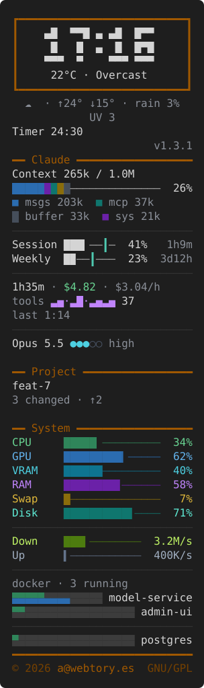
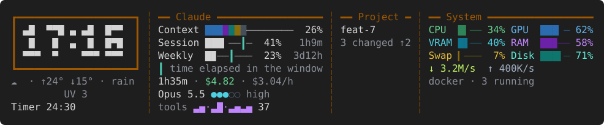
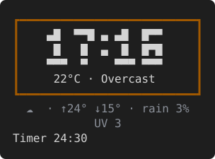
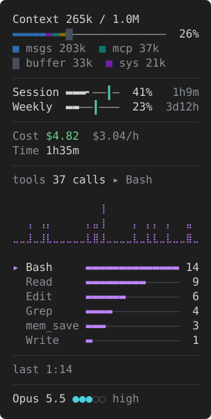
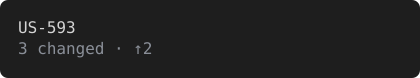
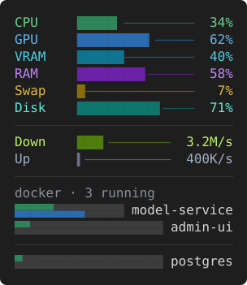

# side-band

A live side band for [Claude Code](https://claude.com/claude-code): a narrow pane docked beside the chat that
shows the time and weather, how much of your Claude plan you have used (and whether you are spending faster than
time passes), the state of the repository you are working in, and what your machine is doing (CPU, GPU, memory,
disk, network and Docker containers).

<p align="center"></p>

It is a Claude Code *mod*: a small TypeScript hooks module, with no build step, that the engine loads and
hot-reloads. It only reads; it never changes your files, your repository or your containers.

- [Install](#install)
- [Use it](#use-it)
- [How it works](#how-it-works)
- [The groups](#the-groups): [Time](#1-time) · [Claude](#2-claude) · [Project](#3-project) · [System](#4-system) · [Footnote and credit](#the-footnote-and-the-credit)
- [Colour guide](#colour-guide)
- [Develop it](#develop-it) (spec-driven)
- [License](#license)

## Install

From the prompt of a terminal Claude Code session:

```
/plugin install side-band --marketplace gopherlian/claude_mod_side_band
```

If the repository is private, the install only works for people who can read it on GitHub and whose machine already
has a git credential for github.com (an SSH key, or `gh auth login` then `gh auth setup-git`).

Answer `y` to *Add marketplace?*, then pick a scope (the user scope keeps it for every session). The band is active
from then on, and it opens by itself in every session you start afterwards. Then set the dock to about 32 columns
wide, once per machine: see [Size](#use-it) under *Use it*.

From a shell, the same thing is:

```
claude plugin install side-band --marketplace gopherlian/claude_mod_side_band
```

To try it from a clone without installing, load the folder for one session:

```
git clone git@github.com:gopherlian/claude_mod_side_band.git
claude --plugin-dir ./claude_mod_side_band
```

`CLAUDE_CODE_PLUGIN_DIRS` does the same where you cannot give a flag (the desktop app, an SDK host): one or more
absolute paths, separated by your platform's path separator.

**What it needs**

| For | It needs | Without it |
| --- | --- | --- |
| Time, Claude, Project | nothing but a terminal session (Project needs `git`) | the group is simply left out |
| Weather | internet access to `api.open-meteo.com` | the clock shows `no weather` |
| CPU, memory, disk, network | Linux (it reads `/proc`, and `df`), also under WSL | those bars are not drawn |
| GPU | `nvidia-smi` (NVIDIA), or an AMD card exposing `gpu_busy_percent` under `/sys/class/drm` | no GPU or VRAM bar |
| NPU | a device under `/sys/class/accel` that reports `npu_busy_time_us` | no NPU bar |
| Containers | `docker` on the `PATH` | no Docker block |
| Plan windows | a Claude subscription that reports rate limits | the Claude group shows context and cost only |

Whatever is not there is left out, never an error.

## Use it

The band opens by itself when a session starts. One command controls it:

| Command | What it does |
| --- | --- |
| `/band` | Hides the band if it is shown, shows it if it is hidden. The choice is remembered for the next sessions. |
| `/band open` | Only shows it (what a new session runs). Never hides. |
| `/band refresh` | Says how often the machine is read. |
| `/band refresh <seconds>` | Sets that interval, from 1 to 300 seconds, live, and remembers it. The default is 5. |
| `/band timer <minutes>` | Starts a countdown, from 1 to 600 minutes. It is drawn under the clock. |
| `/band timer` | Says how much of the countdown is left. |
| `/band timer off` | Clears it. |
| `/band demo` | Turns a demonstration on or off: every element of the band with made-up readings that move (containers, GPU, plan windows, a timer…), to see it all working on any machine. For this session only; nothing is shared or saved. |

When the countdown ends the band shows `Timer done` in green and raises a `Timer done` toast.

**Size.** The band asks for one twelfth of the window width (never fewer than 28 columns of content, never more
than 45% of the window). It is a docked pane: when the window is too short for every group it scrolls with the mouse
wheel, or with the arrow keys while it has focus.

> **The band is wider than that?** Claude Code remembers the width the dock was last resized to and uses it instead of
> what a mod asks for. It is kept in `~/.claude.json`, under `pluginPanes.dockColumns`, for every session and window
> of that user on that machine: a new machine starts from Claude Code's own default, or from whatever width it was
> dragged to there.
>
> The band is designed for **32 columns** (28 of content and 2 of padding on each side). Set it either way, at any
> time:
>
> - **Drag** the left edge of the dock until it is about that wide. It takes effect at once and is remembered.
> - **Edit** `~/.claude.json` with Claude Code closed (it rewrites that file while it runs) and set
>   `"pluginPanes": { "dockColumns": 32 }`, keeping any other keys already under `pluginPanes`.
>
> Narrower still works: what does not fit is wrapped or cut and the big clock turns to plain text. Wider just adds
> room.

## How it works

Everything is in `hooks/`, a single hooks module (`register.tsx`) that the engine loads and hot-reloads when a file
changes.

**Events it listens to**

| Event | What the mod does with it |
| --- | --- |
| `session.start` | Registers `/band`, opens the pane, restores the saved refresh interval, and starts the timers below. |
| `ui.render` (the pane) | Draws the band: it asks each group for its lines and lays them out. |
| `command.run` (`band`) | Answers `/band` and its arguments. |
| `prompt.submit`, `turn.complete` | Time the current and the last turn. |
| `turn.step` | Learns the model and the effort level of the main conversation. |
| `tool.call` | Counts tool calls and knows which one is running. Overlapping calls are counted correctly. |

**What runs on a timer**

- **Every second:** the clock and the timer redraw, so the time and the pace tick stay live.
- **Every 5 seconds** (`/band refresh`): the machine is read: `/proc/stat`, `/proc/meminfo`, `/proc/net/dev`,
  `df`, `nvidia-smi` or the AMD and NPU files, by whichever band's turn comes first (see below). Rates and
  utilisation are *changes* between two readings, so the very first reading only primes them (the mod takes a second
  one a second later, so CPU appears soon).
- **Every third interval:** the slow things: `docker ps`, `docker stats` and `docker inspect` (once for all bands),
  and `git status` (each band, for its own folder).
- **Every 10 minutes:** the weather (once for all bands), from [Open-Meteo](https://open-meteo.com), with no key. The place is fixed
  (Valencia), see [`widgets/weather.ts`](hooks/widgets/weather.ts) to change it.
- **Every 8 seconds:** the plan limits are shared between every open band (see below).

**Plan limits shared between bands.** A session only learns your account's rate limits from its own answers, so an
idle session lags behind a busy one. Every band writes the limits it knows to `~/.claude/side-band-limits.json` and
reads the others', and each shows the highest reading of the current window (usage only grows until the window
resets). A window that has already ended is dropped; a later reset means a new window.

**The machine is read once, not once per session.** What belongs to the machine (CPU, GPU, memory, disk, network,
containers and the weather) is shared through `~/.claude/side-band-state.json`: a band whose turn comes while another
band's reading is younger than its refresh interval shows that reading instead of taking a new one, so every open
session shows the same figures. What belongs to a session (its context, cost, tools, model and the repository of its
folder) stays its own.

**What leaves your machine.** Only the weather request to `api.open-meteo.com`, with the coordinates of the fixed
place. Nothing about your session, files or machine is sent anywhere.

**What it writes.** `~/.claude/side-band-limits.json` (the shared limits), `~/.claude/side-band-state.json` (the
shared machine readings and weather) and the mod's own store (whether the band is hidden, and the refresh interval).
Nothing else.

**The strip.** A docked band is a narrow column, so it stacks the groups. Where a pane cannot be docked (a terminal
under 110 columns wide, such as half or a quarter of a screen, or a terminal that is not in fullscreen mode), the
engine seats it inline above the prompt: short and wide. There the band draws the groups **side by side**, left to
right, each one compact:

<p align="center"></p>

The columns need 99 columns across to show all four groups. Fewer than that and whole groups are dropped, System
first, then Project, then Claude; the time always stays. Width left over is shared among the columns. The strip is
never taller than the rows the pane has, and a column that is taller is cut at the bottom, the least important row
first. The band asks for 8 rows when it opens, which is what the tallest column needs. It has no footnote; the
credit follows the columns where there are rows for all of it.

**How rows are shared out in a docked band.** Each group has a priority. When there are fewer rows than groups need, whole groups are
dropped, the highest priority number first, so the band never shows half a group. The time group always stays. In a
docked pane nothing is dropped, because it scrolls.

| Priority | Group | Dropped |
| --- | --- | --- |
| 0 | Time | never |
| 1 | Claude | fourth |
| 2 | Project | third |
| 3 | System | first |

If rows are left after the groups, the footnote goes at the foot, between a faint grey rule and an orange one, and then
the credit, each whole or not at all.

## The groups

### 1. Time

The time in a big font, centred in a heavy orange frame, with the temperature, the sky, the place, how it feels, the
humidity, the wind and the date centred under it. Under the frame, dimmed and centred, today's outlook: the icon, then high and
low, chance of rain and the UV index (`☁  · ↑24° ↓15° · rain 3% · UV 3`). While a countdown is running, `Timer mm:ss` closes the group.

<p align="center"></p>

The items under the time are ranked by importance. When the band is narrow only the most important ones fit: the
temperature first, then the sky, the place, the date, and last how it feels, the humidity and the wind.

### 2. Claude

What this session and your plan are using.

<p align="center"></p>

From top to bottom:

1. **Context.** Tokens in the context window against its size, and a bar with the percent. The bar is drawn in
   *runs*, one colour per consumer: messages (blue), system prompt and tools (violet), MCP tools (teal) and anything
   else (amber), then the autocompact reserve hatched in grey `▒`, and the free space as the thin track `─`. Under it, a
   legend names the runs with their tokens (`■ msgs 203k  ■ mcp 37k`), largest first.
2. **Session** and **Weekly.** The plan's five-hour and seven-day windows, each as a bar with the percent used and,
   at the end of the row, the time left (`1h9m`, `3d12h`). A spend limit, when your plan has one, is drawn as
   **Spend**. The `┃` on each bar is the *pace tick*, see below.
3. **A faint rule** between the legend of the context runs and the bars, and another before the session's facts.
4. **The session line:** how long it has run, what it has cost (in green), and the cost per hour (after three minutes).
5. **Tools:** a small chart of the tool calls of the last ten minutes (one cell a minute, `·` for a quiet one), the
   total, and the tool running now. Then the current turn's time, or the last one's.
6. **The model and the effort level**, under a faint rule: the model's short name and five pips filled up to the
   effort (`Opus 5.5 ●●●○○ high`).

Without a subscription that reports limits, the Session and Weekly bars are not drawn; if the session cannot report
its usage at all the group says `Usage unavailable`.

**The pace tick.** The bar fills as you use the window. The green `┃` marks how much of the window's *time* has
gone by. If the tick is *inside* the fill, you are spending faster than time passes and may run out before the
window resets; beyond the fill, you are under pace. In the example above, Session has used 41% of its tokens but
77% of its time has gone by: comfortably under pace. The footnote at the foot of the band says this in a
sentence; it only appears when the band has rows to spare. (The strip has no footnote, so there a one-row legend,
`┃ time elapsed in the window`, stands under the bars.)

### 3. Project

Where the repository you are working in stands: the branch, and `clean` or the number of changed files, with `↑n`
commits to push and `↓n` to pull. The group does not appear outside a git repository.

<p align="center"></p>

### 4. System

What the machine is doing, one bar per resource. Each resource has its own colour (see the
[colour guide](#colour-guide)); the bar is the darker shade and its name and number are a lighter shade of the same
colour so they read well.

<p align="center"></p>

- **CPU, GPU, VRAM, NPU:** utilisation in percent. With several GPUs they are numbered (`GPU0`, `VRAM0`…).
- **RAM, Swap, Disk:** memory in use, swap in use, and the disk the session's working directory is on.
- **Down, Up:** network rates. A network bar has no fixed top speed, so it is scaled to the highest rate seen since
  the mod loaded (never below 1 MB/s, so a trickle does not look full).
- **Docker:** one bar per running container, then its name. The bar has two halves: the top half is the container's
  CPU (green) and the bottom half the GPU (blue). Docker does not split a GPU between containers, so a container
  that asked for a GPU shows the GPU's whole utilisation. Containers that share a network (directly or through
  another container) are grouped, with a faint rule between groups. Five are drawn; the rest are counted (`+3 more`).

### The footnote and the credit

At the foot of the band, only when rows are left over, the footnote explains the pace tick. Last of all, the
credit:

<p align="center"></p>

It is one centred row with no frame, `© 2026 a@webtory.es  GNU/GPL`; in a band narrower than that it wraps, each
row centred.

## Colour guide

| What | Colour |
| --- | --- |
| Separators between groups, the group names, the time frame | bright orange `#ff8c00` |
| The credit | dark orange `#b36200` |
| Rules inside a group (`────`) | very faint grey `#3a3a3a` |
| The pace tick `┃` | green |
| Session and Weekly bars, the Context label and percent | default, **yellow from 70%** and **red from 85%** of the window |
| Context runs | messages blue `#2b6cb0` · system violet `#6b21a8` · MCP teal `#0f766e` · other amber `#8a6d0b` · reserve grey `#64748b` |
| Cost · tools chart · effort pips | green `#68d391` · violet `#c084fc` · cyan `#4dd0e1` (faint `#4a5568`) |
| CPU · GPU · VRAM · NPU | green `#2f855a` · blue `#2b6cb0` · cyan `#0e7490` · indigo `#4c51bf` |
| RAM · Swap · Disk | purple `#6b21a8` · mustard `#8a6d0b` · teal `#0f766e` |
| Down · Up | dark lime `#4d7c0f` · slate `#64748b` |
| Timer done | green |

The system colours live in [`hooks/sections/palette.ts`](hooks/sections/palette.ts): one bar colour per resource and
a lighter text colour for its name and number. Orange is kept for the separators between groups and the frames. The system bars do
not turn yellow or red when they fill: each resource keeps its own colour.

## Versions

The mod follows [Semantic Versioning](https://semver.org/spec/v2.0.0.html). The version is in
[`.claude-plugin/plugin.json`](.claude-plugin/plugin.json), each release has a `vX.Y.Z` tag, and
[`CHANGELOG.md`](CHANGELOG.md) says what changed. In this mod:

- **major**: a change that breaks what you rely on: a `/band` command removed or changed, a group removed, a change
  to what it reads or writes;
- **minor**: something new that keeps working as before (a group, a row, a command, an option);
- **patch**: a fix, or a change of look with no new behaviour.

## Develop it

This repository is spec-driven: the behaviour is written in [`specs/`](specs/README.md) before it is built, and the
tests and the code follow from it. The order of work is specify, test, build, fold the change into the specs,
refresh the screenshots, commit. [`AGENTS.md`](AGENTS.md) has the same for coding agents.

```
claude plugin test .                  # runs the tests in hooks/**/*.test.ts
claude plugin validate .              # reads the manifest and the hooks module as the engine will
tools/screenshots/regenerate.sh       # redraws docs/img/*.svg from what the mod really draws
```

```
specs/                 what the band must do: one spec per capability, and changes in progress
.claude-plugin/        plugin.json and marketplace.json
hooks/
  register.tsx         the hooks module: events, timers, sampling, the /band command, the pane
  groups/              one file per group (time, session, project, system), the stacked layout and the strip
  sections/            what a group is made of: usage bars, monitor bars, docker, frame, credit, palette
  monitor/             parsers for /proc, nvidia-smi, AMD and NPU files, df, docker and git output
  widgets/             clock, date and weather
  layout.ts            the band's width and the rows it may take
  limits.ts            the plan limits shared between bands
tools/screenshots/     how the screenshots above are drawn from the mod's own lines
docs/img/              the screenshots (generated: they are redrawn with every visible change)
```

Adding a group is adding a file in `hooks/groups/` that exports a `Group` (an `id`, an optional `label`, a
`priority`, a `lines(ctx)` function and, to be in the strip, a compact `strip` form with its least and most width) and appending it to the list in `hooks/groups/index.ts`, after writing its
spec in `specs/`. Every group reads only its own part of the context. Every file has a test beside it; a change to
what is drawn changes its test.

Two terminal facts the code relies on: `dimColor` replaces a text's colour with the theme's dim one, so anything
coloured is not also dimmed; and a row with more than one colour is drawn from `cells`, runs of text each with its
own colour.

## License

GNU General Public License v3.0 or later. See [`LICENSE`](LICENSE).

© 2026 Alberto Rodriguez Baixauli · a@webtory.es
